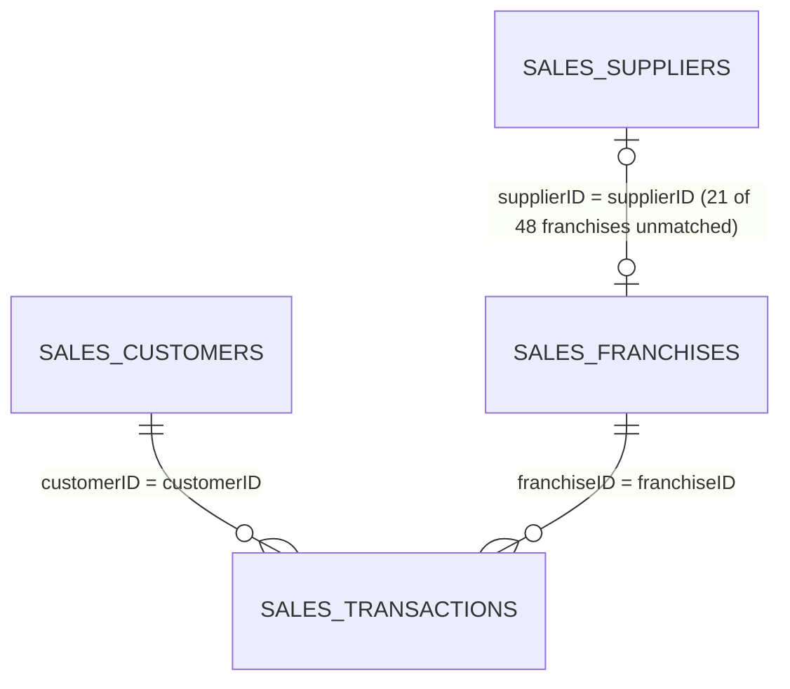

# Data Model Summary — bakehouse_retail_sales

Written by session 04 (wave 1, Deep EDA) in build run 38498872047824. All figures are exact (every table < 10M rows); read-only SQL only.

## Tables
| table | rows | grain | primary_key | role | profile |
|---|---|---|---|---|---|
| samples.bakehouse.sales_transactions | 3333 | one row per point-of-sale transaction (single product line) | transactionID | fact | [sales_transactions](sales_transactions.md) |
| samples.bakehouse.sales_customers | 300 | one row per customer | customerID | dimension | [sales_customers](sales_customers.md) |
| samples.bakehouse.sales_franchises | 48 | one row per franchise store | franchiseID | dimension | [sales_franchises](sales_franchises.md) |
| samples.bakehouse.sales_suppliers | 27 | one row per ingredient supplier | supplierID | dimension | [sales_suppliers](sales_suppliers.md) |

Star schema: `sales_transactions` is the only fact (additive `quantity`, `totalPrice`; two outgoing many-to-one joins). `sales_franchises` snowflakes out to `sales_suppliers`.

## Entity-relationship diagram

## Joins
| left | right | keys | verified_cardinality | orphan_rate | query_used |
|---|---|---|---|---|---|
| samples.bakehouse.sales_transactions | samples.bakehouse.sales_customers | customerID = customerID | many_to_one | 0.0 | WITH l AS (SELECT customerID AS k, count(*) AS n FROM samples.bakehouse.sales_transactions GROUP BY customerID), r AS (SELECT customerID AS k, count(*) AS n FROM samples.bakehouse.sales_customers GROUP BY customerID) SELECT max(l.n) AS max_left_rows_per_key, max(r.n) AS max_right_rows_per_key, count(*) AS matched_keys FROM l JOIN r ON l.k = r.k |
| samples.bakehouse.sales_transactions | samples.bakehouse.sales_franchises | franchiseID = franchiseID | many_to_one | 0.0 | WITH l AS (SELECT franchiseID AS k, count(*) AS n FROM samples.bakehouse.sales_transactions GROUP BY franchiseID), r AS (SELECT franchiseID AS k, count(*) AS n FROM samples.bakehouse.sales_franchises GROUP BY franchiseID) SELECT max(l.n) AS max_left_rows_per_key, max(r.n) AS max_right_rows_per_key, count(*) AS matched_keys FROM l JOIN r ON l.k = r.k |
| samples.bakehouse.sales_franchises | samples.bakehouse.sales_suppliers | supplierID = supplierID | one_to_one | 0.4375 | WITH l AS (SELECT supplierID AS k, count(*) AS n FROM samples.bakehouse.sales_franchises GROUP BY supplierID), r AS (SELECT supplierID AS k, count(*) AS n FROM samples.bakehouse.sales_suppliers GROUP BY supplierID) SELECT max(l.n) AS max_left_rows_per_key, max(r.n) AS max_right_rows_per_key, count(*) AS matched_keys FROM l JOIN r ON l.k = r.k |

Results of the pattern G queries as run:

* transactions -> customers: max_left_rows_per_key 22, max_right_rows_per_key 1, matched_keys 300. Unreferenced customers (pattern D2): 0 of 300.
* transactions -> franchises: max_left_rows_per_key 90, max_right_rows_per_key 1, matched_keys 48. Unreferenced franchises: 0 of 48.
* franchises -> suppliers: max_left_rows_per_key 1, max_right_rows_per_key 1, matched_keys 27. Orphans (pattern D): 21 of 48 franchises (supplierID 4000027-4000047; suppliers cover 4000000-4000026). Unreferenced suppliers: 0 of 27. Through the fact, 1480 of 3333 transactions (44.4%) reach no supplier.

All key pairs are `bigint` on both sides. No declared PK/FK constraints exist in `samples.information_schema.table_constraints` for `bakehouse`; joins were found by name matching and confirmed by usage samples (`franchiseID`, `customerID`, `supplierID` are the most common `JOIN ... ON` columns).

No other candidate joins: `city` / `country` / `continent` / `district` / `size` appear in several tables but describe different entities (customer home, store, supplier location) and are not keys. Customer `country` uses `USA`, franchise `country` uses `US`.

Guidance for synthesis:

* transactions -> customers and transactions -> franchises: inner-safe (0 orphans in both directions); keys are unique on the right, so `rely.at_most_one_match` is safe.
* franchises -> suppliers: must be a LEFT join; supplier attributes are null for 43.75% of franchises. The right key is unique (exact check), so at-most-one-match holds, but an exactly-one-match assumption does not. Supplier-coverage measures should count franchises with a non-null supplier rather than inner-joining.

## Materialization candidates
| table_or_join | signals | suggested dimensions | note |
|---|---|---|---|
| samples.bakehouse.sales_transactions | hot_table, filter_columns | date(dateTime), product, paymentMethod | Top table by usage (3733 queries / 82 users in 30 days). Tiny table (3333 rows): materialization is optional; flag only. |
| sales_transactions -> sales_franchises -> sales_suppliers | multi_join (pending) | sales_franchises.country, sales_franchises.city, sales_suppliers.ingredient | 3-table path needed for supplier coverage per `domain_context`; `docs/research/02_kpi_definitions.md` was empty at profiling time, so the KPI link is unconfirmed. |
| sales_franchises | filter_columns | country, city, size | `country` appears in WHERE in 4 sampled query shapes. |

No `large_table` (all < 10M rows) and no `fan_out` (no join is read from the one side in the stated KPIs; no `many_to_many`). Reading customers or franchises as the base and joining transactions would fan out (up to 22 and 90 rows per key): build measures on the transactions grain.

## Data quality flags
| table | column | issue | impact on metric views |
|---|---|---|---|
| sales_franchises | supplierID | 21 of 48 franchises (43.75%) have no supplier row | LEFT join only; supplier dimensions null for 44.4% of transactions; label nulls (e.g. `Unknown supplier`) |
| sales_transactions | unitPrice | constant 3 in every row | average unit price / price mix measures are uninformative; `totalPrice = quantity * 3` (0 mismatches) |
| sales_transactions | dateTime | 2024-05-01 to 2024-05-17 only; 2024-05-17 is partial (106 rows, ends 11:48) | day/week grains only; flag the partial last day; month or year trends have one data point |
| sales_transactions | cardNumber | unique per row, sensitive | exclude from dimensions; not usable for repeat-payer analysis |
| sales_customers | first_name, last_name, email_address, phone_number, address, city, postal_zip_code | PII | exclude from dimensions; use customerID counts, country, continent, state, gender |
| sales_customers / sales_franchises | country | `USA` vs `US` for the same country | normalize before comparing customer vs store country |
| sales_franchises | name | 2 names reused (`Sugar Rush`, `Sweet Temptations`) | group per store by franchiseID (or name + city) |
| sales_suppliers | approved | constant `Y` | no filter value |

## Not available
* `docs/research/02_kpi_definitions.md` was empty and `docs/context/` held only `00_source_inventory.md` at profiling time (sessions 02 and 03 run in parallel): KPI-driven `multi_join` / `hot_table` (core KPI) signals are not verified against KPI definitions.
* System tables `system.access.table_lineage` and `system.query.history` were available; all lineage and usage checks ran.
