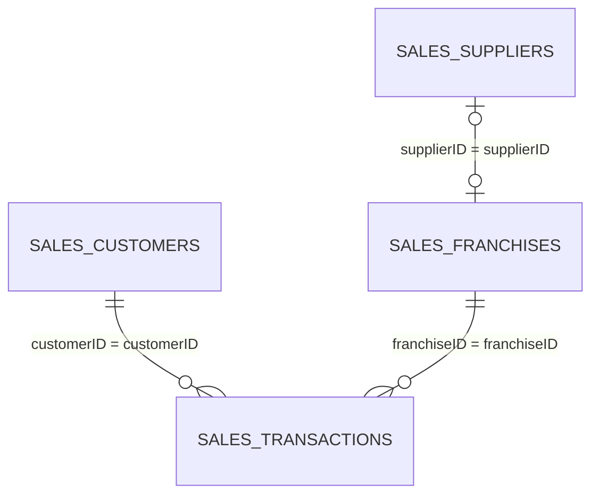

# Data Model Summary — bakehouse_retail_sales

All figures exact (every table is under 10M rows). Read-only SQL only. Source: build session `04`, wave `1`.

## Tables
| table | rows | grain | primary_key | role | profile |
|---|---|---|---|---|---|
| samples.bakehouse.sales_transactions | 3333 | one row per sales transaction (one product line) | transactionID | fact | [sales_transactions](sales_transactions.md) |
| samples.bakehouse.sales_customers | 300 | one row per customer | customerID | dimension | [sales_customers](sales_customers.md) |
| samples.bakehouse.sales_franchises | 48 | one row per franchise store | franchiseID | dimension | [sales_franchises](sales_franchises.md) |
| samples.bakehouse.sales_suppliers | 27 | one row per ingredient supplier | supplierID | dimension | [sales_suppliers](sales_suppliers.md) |

Star schema: `sales_transactions` is the only fact (additive `quantity`, `totalPrice`; two outgoing many-to-one joins). `sales_suppliers` is a snowflake (outrigger) of `sales_franchises`.

## Entity-relationship diagram

## Joins
| left | right | keys | verified_cardinality | orphan_rate | query_used |
|---|---|---|---|---|---|
| samples.bakehouse.sales_transactions | samples.bakehouse.sales_customers | customerID = customerID | many_to_one | 0.0 | WITH l AS (SELECT customerID AS k, count(*) AS n FROM samples.bakehouse.sales_transactions GROUP BY customerID), r AS (SELECT customerID AS k, count(*) AS n FROM samples.bakehouse.sales_customers GROUP BY customerID) SELECT max(l.n) AS max_left_rows_per_key, max(r.n) AS max_right_rows_per_key, count(*) AS matched_keys FROM l JOIN r ON l.k = r.k |
| samples.bakehouse.sales_transactions | samples.bakehouse.sales_franchises | franchiseID = franchiseID | many_to_one | 0.0 | WITH l AS (SELECT franchiseID AS k, count(*) AS n FROM samples.bakehouse.sales_transactions GROUP BY franchiseID), r AS (SELECT franchiseID AS k, count(*) AS n FROM samples.bakehouse.sales_franchises GROUP BY franchiseID) SELECT max(l.n) AS max_left_rows_per_key, max(r.n) AS max_right_rows_per_key, count(*) AS matched_keys FROM l JOIN r ON l.k = r.k |
| samples.bakehouse.sales_franchises | samples.bakehouse.sales_suppliers | supplierID = supplierID | one_to_one | 0.4375 | WITH l AS (SELECT supplierID AS k, count(*) AS n FROM samples.bakehouse.sales_franchises GROUP BY supplierID), r AS (SELECT supplierID AS k, count(*) AS n FROM samples.bakehouse.sales_suppliers GROUP BY supplierID) SELECT max(l.n) AS max_left_rows_per_key, max(r.n) AS max_right_rows_per_key, count(*) AS matched_keys FROM l JOIN r ON l.k = r.k |

Pattern G results: transactions -> customers max_left 22, max_right 1, matched 300; transactions -> franchises max_left 90, max_right 1, matched 48; franchises -> suppliers max_left 1, max_right 1, matched 27.

Unreferenced right keys (pattern D2): customers 0/300 (0.0), franchises 0/48 (0.0), suppliers 0/27 (0.0).

Notes for synthesis:
* All right keys are unique (pattern C), so each join matches at most one right row; `rely.at_most_one_match` is safe on all three joins.
* franchises -> suppliers is `one_to_one` in the current data (each franchise has a distinct supplierID), but 21 of 48 franchises (supplierIDs 4000027-4000047) have no supplier row. Use a LEFT join; supplier attributes are NULL for those franchises (not an INNER join, which drops 43.75% of franchises and their sales).
* transactions -> suppliers is a derived path (transactions -> franchises -> suppliers), many_to_one end to end; 1480 of 3333 transactions (44.4%) belong to a franchise with no supplier row, so supplier-level sales measures cover only 55.6% of revenue rows unless NULL suppliers are shown as an `Unknown supplier` bucket.
* No declared PK/FK constraints exist in `samples.information_schema`; all joins come from name matching and were verified above.

## Materialization candidates
| table_or_join | signals | suggested dimensions | note |
|---|---|---|---|
| samples.bakehouse.sales_transactions | hot_table | product, paymentMethod, date(dateTime) | Highest queries_30d (3762). Only 3333 rows, so materialization is optional; no large_table signal |
| sales_transactions -> sales_franchises -> sales_suppliers | multi_join | sales_franchises.country, sales_suppliers.ingredient, sales_suppliers.continent | Supplier Concentration by franchise sales (02_kpi_definitions) needs 3 tables |
| sales_transactions -> sales_customers | fan_out | sales_customers.country, gender | Customer counts read through the fact must be count(DISTINCT customerID) |
| sales_transactions -> sales_franchises | fan_out | sales_franchises.country, city, size | Franchise counts through the fact must be count(DISTINCT franchiseID); filter_columns: name |

## Data quality flags
| table | column | issue | impact on metric views |
|---|---|---|---|
| samples.bakehouse.sales_franchises | supplierID | 43.75% orphans (21 of 48 franchises; supplierIDs 4000027-4000047 absent from sales_suppliers) | LEFT join; supplier dimensions NULL for those franchises; define Approved Supplier Rate explicitly (27/48 = 56.25% counting missing as not approved) |
| samples.bakehouse.sales_suppliers | approved | constant `Y` (27/27) | Approved flag does not discriminate among matched suppliers |
| samples.bakehouse.sales_transactions | unitPrice | constant 3, currency not stated | Average Unit Price is always 3; revenue = 3 * units |
| samples.bakehouse.sales_transactions | dateTime | covers 2024-05-01 to 2024-05-17 only (2024-05-17 partial: 106 txns vs 181-229 per full day) | No YoY / same-store growth over years; retention only within short windows; annualised AUV is an extrapolation |
| samples.bakehouse.sales_customers / sales_franchises | country | customers use `USA`, franchises use `US` | Do not compare or union country labels across the two tables without mapping |
| samples.bakehouse.sales_customers | state | mixed full names and abbreviations (e.g. `MS` and `Mississippi`) | Normalize before using as a dimension |
| samples.bakehouse.sales_franchises | name | not unique (Sugar Rush, Sweet Temptations twice) | Group by franchiseID, display name |
| samples.bakehouse.sales_transactions | cardNumber | sensitive; unique per row | Exclude from metric views; not a customer key |

Answers to open questions in `docs/research/02_kpi_definitions.md`:
* `transactionID` is unique per row (count(*) = count(DISTINCT transactionID) = 3333).
* `totalPrice = quantity * unitPrice` on every row (0 mismatches); prices are integers, currency not stated.
* `dateTime` range: 2024-05-01 00:03 to 2024-05-17 11:48.
* `approved` takes only `Y`; `paymentMethod` takes `mastercard`, `amex`, `visa`.
* Every customer (300/300) buys at more than one franchise (max 18): customer is not nested under franchise.
* Every supplier serves exactly one franchise.

## Not available
None. `system.access.table_lineage` and `system.query.history` were readable; `samples.information_schema.table_constraints` returned no constraints (none declared).
