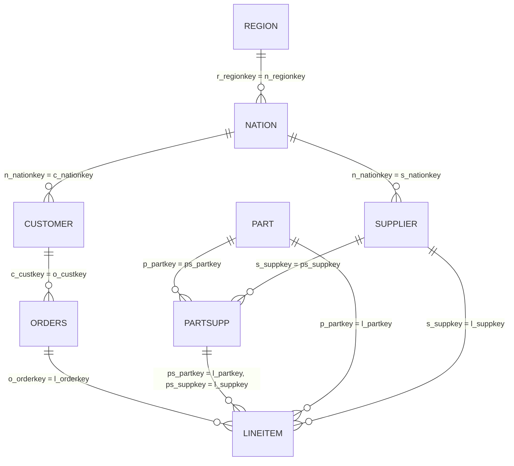

# Data Model Summary — tpch_supply_chain

Source: `samples.tpch` (8 tables). Profiled with the `ontology-deep-eda` skill using read-only SQL. `lineitem` (> 10M rows) uses 1% `TABLESAMPLE` for null rates and distributions and `approx_count_distinct` for distinct counts; grain and join checks ran exactly on full tables for every table.

## Tables
| table | rows | grain | primary_key | role | profile |
|---|---|---|---|---|---|
| samples.tpch.customer | 750000 | one row per customer | c_custkey | dimension | [customer](customer.md) |
| samples.tpch.orders | 7500000 | one row per order | o_orderkey | fact | [orders](orders.md) |
| samples.tpch.lineitem | 29999795 | one row per order line (order x line number) | l_orderkey, l_linenumber | fact | [lineitem](lineitem.md) |
| samples.tpch.part | 1000000 | one row per part | p_partkey | dimension | [part](part.md) |
| samples.tpch.partsupp | 4000000 | one row per part-supplier offer (part x supplier) | ps_partkey, ps_suppkey | bridge | [partsupp](partsupp.md) |
| samples.tpch.supplier | 50000 | one row per supplier | s_suppkey | dimension | [supplier](supplier.md) |
| samples.tpch.nation | 25 | one row per nation | n_nationkey | dimension | [nation](nation.md) |
| samples.tpch.region | 5 | one row per region | r_regionkey | dimension | [region](region.md) |

## Entity-relationship diagram

## Joins
| left | right | keys | verified_cardinality | orphan_rate | query_used |
|---|---|---|---|---|---|
| samples.tpch.orders | samples.tpch.customer | o_custkey = c_custkey | many_to_one | 0.0 | WITH l AS (SELECT o_custkey AS k, count(*) AS n FROM samples.tpch.orders GROUP BY o_custkey), r AS (SELECT c_custkey AS k, count(*) AS n FROM samples.tpch.customer GROUP BY c_custkey) SELECT max(l.n) AS max_left_rows_per_key, max(r.n) AS max_right_rows_per_key, count(*) AS matched_keys FROM l JOIN r ON l.k = r.k |
| samples.tpch.lineitem | samples.tpch.orders | l_orderkey = o_orderkey | many_to_one | 0.0 | WITH l AS (SELECT l_orderkey AS k, count(*) AS n FROM samples.tpch.lineitem GROUP BY l_orderkey), r AS (SELECT o_orderkey AS k, count(*) AS n FROM samples.tpch.orders GROUP BY o_orderkey) SELECT max(l.n) AS max_left_rows_per_key, max(r.n) AS max_right_rows_per_key, count(*) AS matched_keys FROM l JOIN r ON l.k = r.k |
| samples.tpch.lineitem | samples.tpch.partsupp | l_partkey = ps_partkey, l_suppkey = ps_suppkey | many_to_one | 0.0 | WITH l AS (SELECT l_partkey AS k0, l_suppkey AS k1, count(*) AS n FROM samples.tpch.lineitem GROUP BY l_partkey, l_suppkey), r AS (SELECT ps_partkey AS k0, ps_suppkey AS k1, count(*) AS n FROM samples.tpch.partsupp GROUP BY ps_partkey, ps_suppkey) SELECT max(l.n) AS max_left_rows_per_key, max(r.n) AS max_right_rows_per_key, count(*) AS matched_keys FROM l JOIN r ON l.k0 = r.k0 AND l.k1 = r.k1 |
| samples.tpch.lineitem | samples.tpch.part | l_partkey = p_partkey | many_to_one | 0.0 | WITH l AS (SELECT l_partkey AS k, count(*) AS n FROM samples.tpch.lineitem GROUP BY l_partkey), r AS (SELECT p_partkey AS k, count(*) AS n FROM samples.tpch.part GROUP BY p_partkey) SELECT max(l.n) AS max_left_rows_per_key, max(r.n) AS max_right_rows_per_key, count(*) AS matched_keys FROM l JOIN r ON l.k = r.k |
| samples.tpch.lineitem | samples.tpch.supplier | l_suppkey = s_suppkey | many_to_one | 0.0 | WITH l AS (SELECT l_suppkey AS k, count(*) AS n FROM samples.tpch.lineitem GROUP BY l_suppkey), r AS (SELECT s_suppkey AS k, count(*) AS n FROM samples.tpch.supplier GROUP BY s_suppkey) SELECT max(l.n) AS max_left_rows_per_key, max(r.n) AS max_right_rows_per_key, count(*) AS matched_keys FROM l JOIN r ON l.k = r.k |
| samples.tpch.partsupp | samples.tpch.part | ps_partkey = p_partkey | many_to_one | 0.0 | WITH l AS (SELECT ps_partkey AS k, count(*) AS n FROM samples.tpch.partsupp GROUP BY ps_partkey), r AS (SELECT p_partkey AS k, count(*) AS n FROM samples.tpch.part GROUP BY p_partkey) SELECT max(l.n) AS max_left_rows_per_key, max(r.n) AS max_right_rows_per_key, count(*) AS matched_keys FROM l JOIN r ON l.k = r.k |
| samples.tpch.partsupp | samples.tpch.supplier | ps_suppkey = s_suppkey | many_to_one | 0.0 | WITH l AS (SELECT ps_suppkey AS k, count(*) AS n FROM samples.tpch.partsupp GROUP BY ps_suppkey), r AS (SELECT s_suppkey AS k, count(*) AS n FROM samples.tpch.supplier GROUP BY s_suppkey) SELECT max(l.n) AS max_left_rows_per_key, max(r.n) AS max_right_rows_per_key, count(*) AS matched_keys FROM l JOIN r ON l.k = r.k |
| samples.tpch.customer | samples.tpch.nation | c_nationkey = n_nationkey | many_to_one | 0.0 | WITH l AS (SELECT c_nationkey AS k, count(*) AS n FROM samples.tpch.customer GROUP BY c_nationkey), r AS (SELECT n_nationkey AS k, count(*) AS n FROM samples.tpch.nation GROUP BY n_nationkey) SELECT max(l.n) AS max_left_rows_per_key, max(r.n) AS max_right_rows_per_key, count(*) AS matched_keys FROM l JOIN r ON l.k = r.k |
| samples.tpch.supplier | samples.tpch.nation | s_nationkey = n_nationkey | many_to_one | 0.0 | WITH l AS (SELECT s_nationkey AS k, count(*) AS n FROM samples.tpch.supplier GROUP BY s_nationkey), r AS (SELECT n_nationkey AS k, count(*) AS n FROM samples.tpch.nation GROUP BY n_nationkey) SELECT max(l.n) AS max_left_rows_per_key, max(r.n) AS max_right_rows_per_key, count(*) AS matched_keys FROM l JOIN r ON l.k = r.k |
| samples.tpch.nation | samples.tpch.region | n_regionkey = r_regionkey | many_to_one | 0.0 | WITH l AS (SELECT n_regionkey AS k, count(*) AS n FROM samples.tpch.nation GROUP BY n_regionkey), r AS (SELECT r_regionkey AS k, count(*) AS n FROM samples.tpch.region GROUP BY r_regionkey) SELECT max(l.n) AS max_left_rows_per_key, max(r.n) AS max_right_rows_per_key, count(*) AS matched_keys FROM l JOIN r ON l.k = r.k |

Pattern G results (max_left_rows_per_key / max_right_rows_per_key / matched_keys): orders->customer 43 / 1 / 499,989; lineitem->orders 7 / 1 / 7,500,000; lineitem->partsupp 26 / 1 / 3,998,050; lineitem->part 61 / 1 / 1,000,000; lineitem->supplier 712 / 1 / 50,000; partsupp->part 4 / 1 / 1,000,000; partsupp->supplier 80 / 1 / 50,000; customer->nation 30,401 / 1 / 25; supplier->nation 2,065 / 1 / 25; nation->region 5 / 1 / 5. All joins are exact (full table, no approx fallback), so `rely.at_most_one_match` is safe on every join above. `orphan_rate` is from pattern D (left rows with no right match); every left key matched.

`lineitem -> part` and `lineitem -> supplier` are listed in addition to the composite `lineitem -> partsupp` join; both are valid many_to_one shortcuts.

## Star-schema notes
* Facts: `lineitem` (order-line grain, additive `l_quantity`, `l_extendedprice`, discount/tax rates) and `orders` (order grain, `o_totalprice`). `lineitem` is the natural metric view source; `orders` is its first dimension hop.
* Snowflake dimensions: `customer -> nation -> region` and `supplier -> nation -> region`. `nation` / `region` must be joined twice under distinct aliases when both customer and supplier geography are needed.
* `partsupp` is a bridge (part x supplier offer) with its own measures (`ps_availqty`, `ps_supplycost`). Supply cost per line needs the composite `lineitem -> partsupp` join.
* Date columns for time dimensions: `o_orderdate` (1992-01-01..1998-08-02), `l_shipdate`, `l_commitdate`, `l_receiptdate` (1992..1998).

## Materialization candidates
| table_or_join | signals | suggested dimensions | note |
|---|---|---|---|
| samples.tpch.lineitem | large_table, multi_join | l_shipdate (month), l_returnflag, l_linestatus, l_shipmode | 30M rows; core revenue source |
| lineitem -> orders -> customer -> nation -> region | multi_join, hot_table (orders, nation) | o_orderdate (month), c_mktsegment, n_name, r_name, o_orderpriority | revenue by segment / geography |
| lineitem -> partsupp -> part / supplier | multi_join, fan_out (if partsupp measures are read through lineitem) | p_brand, p_type, p_mfgr, supplier nation | supply cost and profit; keep `ps_*` measures at partsupp grain |
| orders -> lineitem | fan_out | o_orderstatus, o_orderpriority | never sum `o_totalprice` through lineitem |

## Data quality flags
| table | column | issue | impact on metric views |
|---|---|---|---|
| samples.tpch.customer | c_custkey | 250,011 of 750,000 customers (33.3%) have no orders | customer counts must come from `customer`, not from an orders-based view |
| samples.tpch.partsupp | ps_partkey, ps_suppkey | 1,950 of 4,000,000 offers have no line items | offer counts / inventory must come from `partsupp` |
| samples.tpch.orders | o_shippriority | constant 0 | exclude as a dimension |
| samples.tpch.orders | o_totalprice | order-level total | summing through `lineitem` double counts (up to 7x) |
| samples.tpch.customer | c_phone | 749,992 distinct for 750,000 rows | not a key |
| all | - | null rate 0.0 observed for every column (lineitem from a 1% sample); no declared PK/FK constraints | joins rely on verified data, not UC constraints |

## Not available
* Declared constraints: `samples.information_schema.table_constraints` and `key_column_usage` return no rows for `tpch` (no PK/FK declared); joins were derived from name matching and verified with patterns D and G.
* Lineage and usage: available (`system.access.table_lineage`, `system.query.history`), but sample data is shared, so downstream names are workspace-specific and omitted; lineage queries hit LIMIT 50 for most tables.
* Usage filter columns come from a 400-statement sample of `samples.tpch` queries; no `JOIN ... ON` columns were extracted from it.
