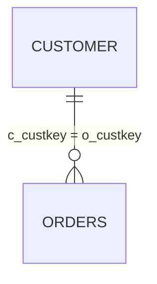

# Ontology Deep EDA

Profile every source table and verify how the tables join. Metric view synthesis builds `source`, `joins`, dimensions and measures from these profiles, and the metric view validator (rule MV005) reads `verified_cardinality` from the summary's join table, so a wrong cardinality becomes a wrong measure.

## Inputs

* `sdk_config.json` at the run project root: `source_catalogs` / `source_schemas` / `source_tables` (expand to a table list with `genie_ontology_modeled_knowledge_sdk.config.expand_tables`, or `information_schema.tables` when the library is not importable), `warehouse_id`.
* `docs/research/02_kpi_definitions.md` and `docs/context/*.md` if present: KPI formulas and stated joins to verify.
* Paths below are relative to the run project root.

## Guardrails

* **Read-only SQL**: `SELECT`, `DESCRIBE`, `SHOW`, `EXPLAIN` only. No `CREATE`, `INSERT`, `OPTIMIZE`, `ANALYZE`, temp tables written to UC, Git commands or file deletion.
* **Write only** `docs/data_profiles/**`.
* **Bound every query**: `LIMIT` result sets you print (top-N value lists at 20), and follow the sampling rules for large tables.
* **No row-level values from sensitive columns** (names, emails, phone, address, free text) in profiles: report counts and rates only.
* Large table sets: profile in table order and record progress after each table, so a continuation pass resumes at the next one.

## Sampling rules (tables > 10M rows)

Get the row count first (`DESCRIBE DETAIL` `numFiles`/`sizeInBytes` is free; `SELECT count(*)` is cheap on Delta). If `row_count > 10,000,000` (the default `large_table_rows` threshold):

| Measure | Rule |
|---|---|
| null rate, value distributions, min/max | `FROM <t> TABLESAMPLE (1 PERCENT) REPEATABLE (42)` (at least ~100K rows; raise the percent for tables under 100M rows if the sample is smaller) |
| distinct counts | `approx_count_distinct(col)` on the full table (no sample) |
| grain / uniqueness and join cardinality | **full table, exact** (`GROUP BY ... HAVING count(*) > 1 LIMIT 1`). A sample cannot prove uniqueness. If it times out, use the approx check below and mark `query_used` with `(approx)` |

State in each profile whether figures are `exact` or `sampled (1%)`.

## Per-table checklist

Run these for every table `<t>` (fully qualified `catalog.schema.table`).

| # | Analysis | SQL pattern |
|---|---|---|
| 1 | Structure | `DESCRIBE TABLE EXTENDED <t>`: types, nested structs, comments, partitioning/clustering |
| 2 | Volume | `DESCRIBE DETAIL <t>` (`sizeInBytes`, `numFiles`, `clusteringColumns`); `SELECT count(*) FROM <t>` |
| 3 | Null rate / distinct | pattern A |
| 4 | Distributions | pattern B for columns with < 100 distinct values; min/max/avg for numeric and date columns |
| 5 | Grain | pattern C on the declared or candidate key; record what one row represents |
| 6 | Declared constraints | `SELECT * FROM <catalog>.information_schema.table_constraints WHERE table_schema = '<s>' AND table_name = '<t>'` and `key_column_usage` (hints only; UC PK/FK are not enforced) |
| 7 | Update cadence | `DESCRIBE HISTORY <t> LIMIT 20`: last write, operations (`WRITE`, `MERGE`, `STREAMING UPDATE`), interval between commits |
| 8 | Lineage | pattern E (system tables, with fallback) |
| 9 | Usage | pattern F (system tables, with fallback) |

**Pattern A: null rate and distinct count** (generate one expression pair per column from the `DESCRIBE` output):

```sql
SELECT count(*) AS row_count,
       count_if(c_mktsegment IS NULL) / count(*) AS c_mktsegment__null_rate,
       approx_count_distinct(c_mktsegment)       AS c_mktsegment__distinct
       -- ... one pair per column
FROM samples.tpch.customer
-- add TABLESAMPLE (1 PERCENT) REPEATABLE (42) after the table name for tables > 10M rows (null rates only)
```

Use `count(DISTINCT col)` instead of `approx_count_distinct` for tables <= 10M rows. `uniqueness_ratio = distinct / row_count`; 1.0 marks a candidate key.

**Pattern B: top values**

```sql
SELECT c_mktsegment AS value, count(*) AS n, round(100 * count(*) / sum(count(*)) OVER (), 2) AS pct
FROM samples.tpch.customer
GROUP BY 1 ORDER BY n DESC LIMIT 20
```

**Pattern C: grain test** (returns 0 rows when the key is unique):

```sql
SELECT l_orderkey, l_linenumber, count(*) AS n
FROM samples.tpch.lineitem
GROUP BY l_orderkey, l_linenumber
HAVING count(*) > 1
LIMIT 5
```

Try single columns with `uniqueness_ratio = 1.0` first, then the smallest column combinations suggested by names (`*_key`, `*_id`, `*_number`, `*_date`).

## Cross-table checklist

1. **Join key candidates**: same or suffix-matching column names across tables (`o_custkey` / `c_custkey`, `customer_id` / `id`), declared FKs, and joins stated in `docs/context/`. Check that the types are compatible.
2. **Value overlap and orphans** for each candidate (pattern D).
3. **Cardinality verification** for each candidate (pattern G). Orient each join from the many side (`left`, usually the fact) to the one side (`right`, the dimension).
4. **Star schema detection**: a fact table has numeric additive columns, high row count and several outgoing many-to-one joins; a dimension is the `right` side of many-to-one joins with a unique key.

**Pattern D: FK overlap / orphan rate**

```sql
SELECT count(*)                                AS left_rows,
       count_if(r.c_custkey IS NULL)           AS orphan_rows,
       count_if(r.c_custkey IS NULL) / count(*) AS orphan_rate
FROM samples.tpch.orders l
LEFT JOIN (SELECT DISTINCT c_custkey FROM samples.tpch.customer) r
  ON l.o_custkey = r.c_custkey
```

**Pattern G: cardinality verification** (run exactly; this is the `query_used` you record):

```sql
WITH l AS (SELECT o_custkey AS k, count(*) AS n FROM samples.tpch.orders   GROUP BY o_custkey),
     r AS (SELECT c_custkey AS k, count(*) AS n FROM samples.tpch.customer GROUP BY c_custkey)
SELECT max(l.n) AS max_left_rows_per_key,
       max(r.n) AS max_right_rows_per_key,
       count(*) AS matched_keys
FROM l JOIN r ON l.k = r.k
```

| `max_left_rows_per_key` | `max_right_rows_per_key` | `verified_cardinality` |
|---|---|---|
| > 1 | 1 | `many_to_one` |
| 1 | 1 | `one_to_one` |
| any | > 1 | `many_to_many` (if left is 1 and right > 1, swap left/right and re-run: it is `many_to_one` the other way) |

For composite keys, group by every key column (or `struct(k1, k2)`). Approx fallback for timeouts: compare `approx_count_distinct(k)` to `count(*)` on the right table; equal within 1% suggests a unique right key, record `query_used` with `(approx)`, and tell synthesis not to set `rely.at_most_one_match` on that join.

**Pattern E: lineage** (`system.access.table_lineage`):

```sql
SELECT source_table_full_name, target_table_full_name, entity_type, max(event_time) AS last_seen
FROM system.access.table_lineage
WHERE (source_table_full_name = '<t>' OR target_table_full_name = '<t>')
  AND event_date >= current_date() - INTERVAL 90 DAYS
GROUP BY ALL
LIMIT 50
```

**Pattern F: usage** (`system.query.history`):

```sql
SELECT count(*) AS queries_30d, count(DISTINCT executed_by) AS users_30d
FROM system.query.history
WHERE start_time >= current_timestamp() - INTERVAL 30 DAYS
  AND execution_status = 'FINISHED'
  AND lower(statement_text) LIKE '%<schema>.<table>%'
```

For common joins and filter columns, sample up to 20 matching `statement_text` values (`LIMIT 20`) and note the `JOIN ... ON` and `WHERE` columns. Never copy statement text into a profile, only the column names.

**Fallback when system tables are denied or missing** (`INSUFFICIENT_PERMISSIONS`, `TABLE_OR_VIEW_NOT_FOUND`, `SCHEMA_NOT_FOUND`): do not retry or ask for grants. Write `Lineage: not available (<error class>)` / `Usage: not available (<error class>)` in the profile, use `DESCRIBE HISTORY` for cadence, use declared constraints and name matching for joins, and continue. This is not a session failure.

## Materialization signals

Flag a table or join in the summary when any of these holds (thresholds are defaults; the run plan may override them):

| Signal | Rule |
|---|---|
| `large_table` | `row_count > 10,000,000` |
| `multi_join` | a KPI from `02_kpi_definitions.md` needs 3+ tables |
| `fan_out` | a `many_to_one` join read from the one side, or any `many_to_many` (measures risk double counting) |
| `hot_table` | `queries_30d` in the top quartile of source tables, or a KPI in `02` marked core |
| `filter_columns` | columns that appear in `WHERE` in usage samples: candidate materialization dimensions (categorical only) |

Synthesis turns these into `materialization:` blocks; this stage only flags them.

## Outputs

### Table profile (`docs/data_profiles/<table>.md`)

`<table>` is the table name; if two source schemas share a name, use `<schema>__<table>`.

```markdown
# Profile: <catalog.schema.table>

* Rows: <n> | Size: <bytes> | Files: <n> | Figures: exact | sampled (1%)
* Grain: one row per <entity> | Primary key: <cols> (verified by pattern C) | Role: fact | dimension | bridge
* Update cadence: <batch daily / streaming / static>, last write <date> (DESCRIBE HISTORY)

## Columns
| column | type | null_rate | distinct | uniqueness_ratio | role (key, fk, measure, dimension, date, text) | comment |
|---|---|---|---|---|---|---|

## Value distributions
<Top values for categorical columns (< 100 distinct); min/max for numeric and date columns.>

## Keys and joins
| column | references | orphan_rate | verified_cardinality |
|---|---|---|---|

## Lineage
<Upstream / downstream tables, or "not available (<error class>)".>

## Usage
<queries_30d, users_30d, common join and filter columns, or "not available (<error class>)".>

## Data quality flags
<High null rates on keys, orphans, duplicates on the grain, suspicious ranges.>

## Materialization signals
<Flags from the table above, or none.>
```

### Data model summary (`docs/data_profiles/data_model_summary.md`)

The `## Joins` table is a cross-session contract: keep these six columns, in this order, with these names. `verified_cardinality` is exactly `many_to_one`, `one_to_one` or `many_to_many`. `keys` uses `left_col = right_col` (comma-separate composite keys). `query_used` is the pattern G query as run, on one line.

~~~markdown
# Data Model Summary — <domain_name>

## Tables
| table | rows | grain | primary_key | role | profile |
|---|---|---|---|---|---|
| samples.tpch.orders | <row_count> | one row per order | o_orderkey | fact | [orders](orders.md) |

## Entity-relationship diagram


## Joins
| left | right | keys | verified_cardinality | orphan_rate | query_used |
|---|---|---|---|---|---|
| samples.tpch.orders | samples.tpch.customer | o_custkey = c_custkey | many_to_one | 0.0 | WITH l AS (...) SELECT max(l.n) ... |

## Materialization candidates
| table_or_join | signals | suggested dimensions | note |
|---|---|---|---|

## Data quality flags
| table | column | issue | impact on metric views |
|---|---|---|---|

## Not available
<System tables or checks that could not run, with the error class.>
~~~

## Output checklist

The session runner verifies these before reporting `pass`:

- [ ] One `docs/data_profiles/<table>.md` per source table from `sdk_config.json`, each with Grain, Primary key and a `## Columns` table with `null_rate` and `distinct`.
- [ ] Every profile states `exact` or `sampled (1%)`; tables > 10M rows used `TABLESAMPLE` / `approx_count_distinct` per the sampling rules, and exact grain checks.
- [ ] `docs/data_profiles/data_model_summary.md` exists with `## Tables`, a Mermaid ER diagram, `## Joins` (columns `left`, `right`, `keys`, `verified_cardinality`, `orphan_rate`, `query_used`), `## Materialization candidates`.
- [ ] Every `verified_cardinality` value is `many_to_one`, `one_to_one` or `many_to_many`, and every row has a non-empty `query_used`.
- [ ] Lineage and usage sections are filled or say `not available (<error class>)`.
- [ ] Only read-only SQL ran; no Git commands, no file deletion, no sensitive row values or workspace-specific identifiers in outputs.
